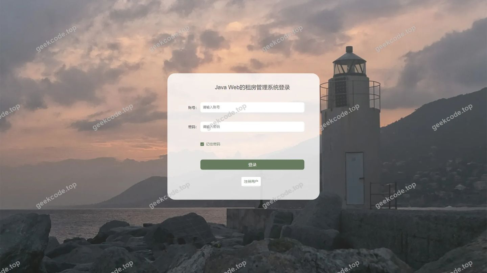
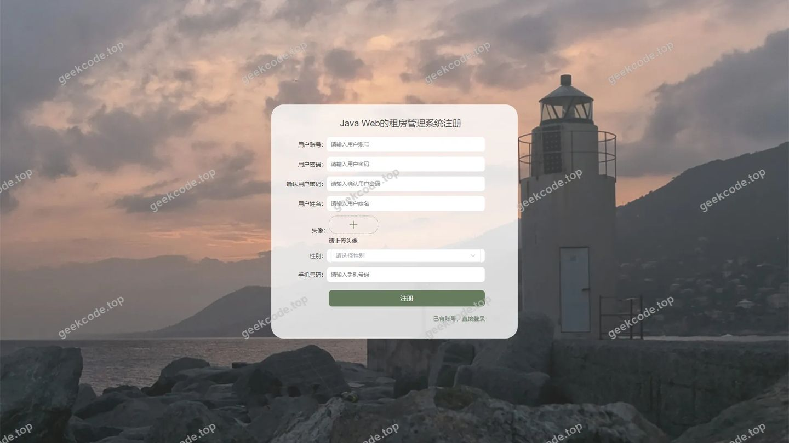
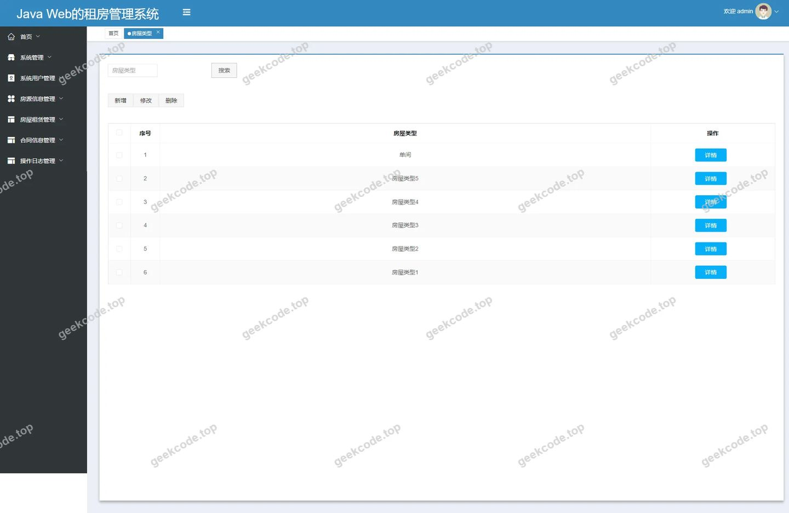
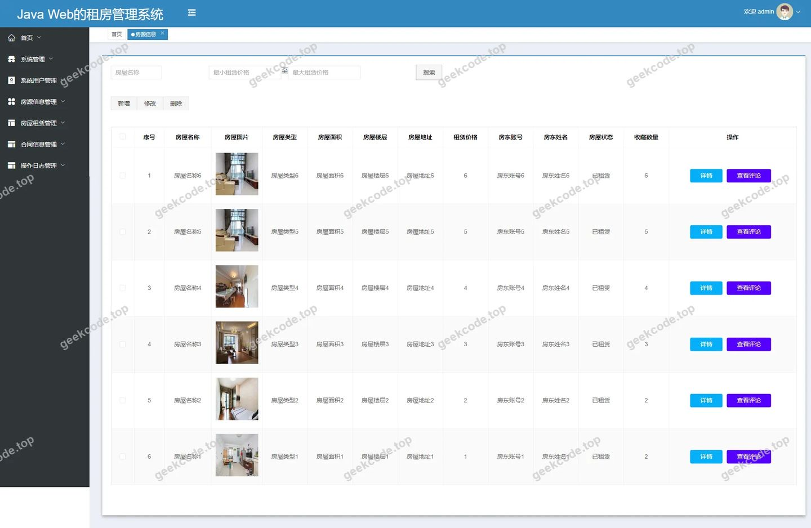
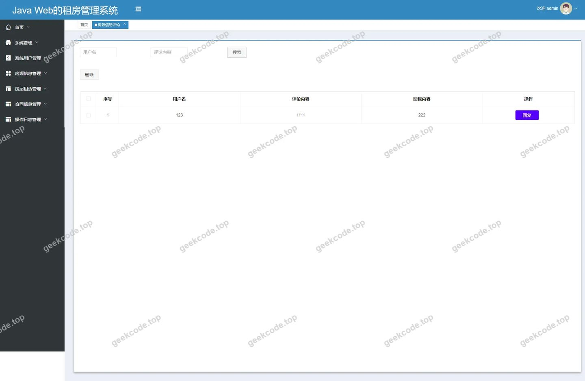
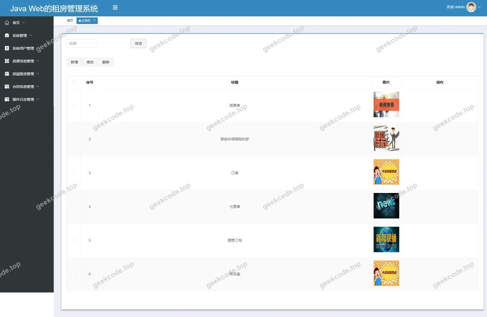
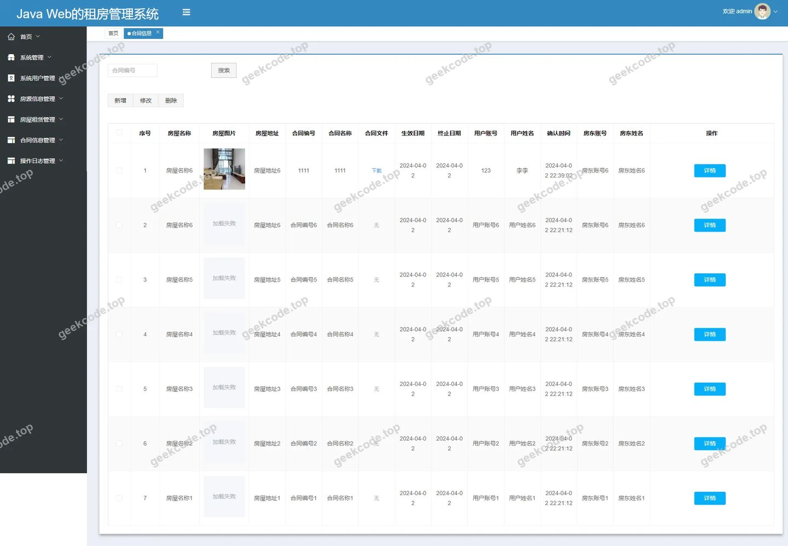
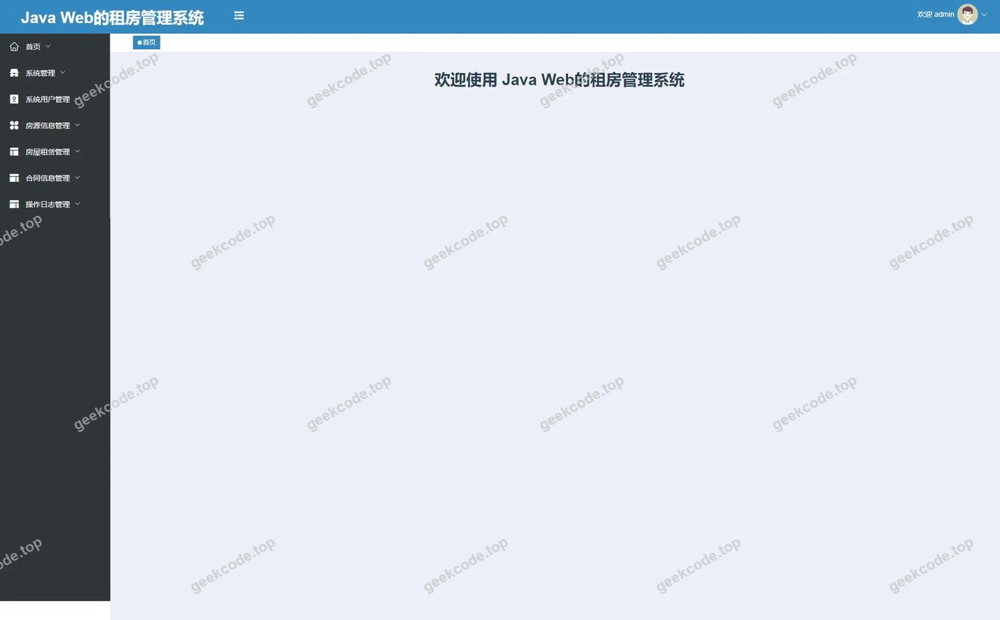
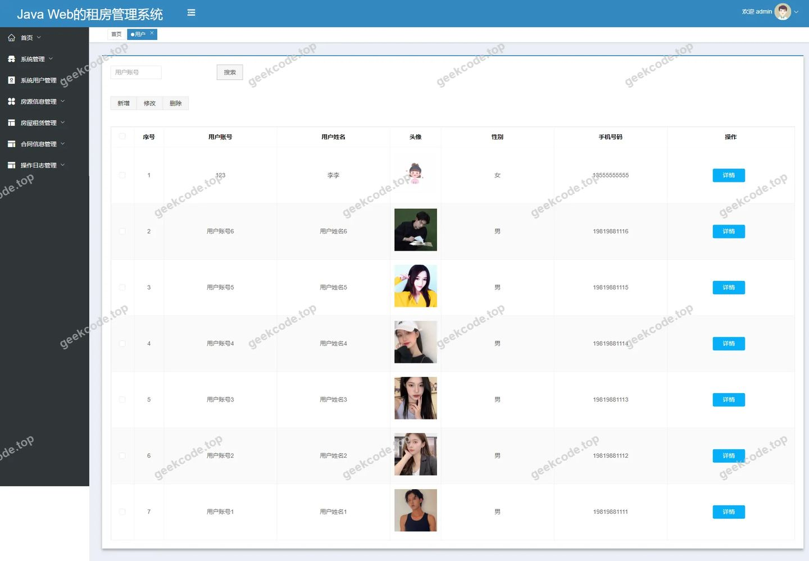

# [springboot]Java Web的租房管理系统

> 🎓 **计算机毕业设计 · [springboot]Java Web的租房管理系统**
>
> 本仓库只放**项目介绍 + 运行截图**（截图是站点带水印的原图，存在仓库 `images/` 里）。
>
> 👉 **完整可运行源码 / 数据库脚本 / 部署文档：[点我获取](https://geekcode.top/archives/springboot-Java-Web%E7%9A%84%E7%A7%9F%E6%88%BF%E7%AE%A1%E7%90%86%E7%B3%BB%E7%BB%9F?utm_source=github)**
>
> 💬 咨询微信：**ir9372**　|　🌐 更多项目：[极客代码 geekcode.top](https://geekcode.top/?utm_source=github)
>
> 📌 项目详情页：<https://geekcode.top/archives/springboot-Java-Web%E7%9A%84%E7%A7%9F%E6%88%BF%E7%AE%A1%E7%90%86%E7%B3%BB%E7%BB%9F?utm_source=github>

<table><td width="230" align="center"> <b>扫码加微信 ir9372</b></td><td valign="middle">📦 源码 = 项目介绍 + 全部运行截图 + 数据库 + 部署文档 👉 点上方任意截图，直接跳到 <b>极客代码 geekcode.top</b> 详情页</td></table>

---

<h1>[springboot]Java Web的租房管理系统</h1>
<h2>项目概述</h2>

本项目为基于 Java Web 技术的租房管理系统，旨在解决传统房屋租赁市场中信息分散、管理效率低下及流程不透明等痛点。系统采用前后端分离架构，核心功能涵盖房源信息管理、房屋类型分类、租赁业务办理、合同生成与管理以及用户评论互动等模块。适用人群包括寻求房源的租客、发布房源的房东以及负责平台运营与监管的管理员。技术架构上，后端依托 Spring Boot 框架实现高效的服务部署，结合 MyBatis-Plus 简化数据持久层操作，并引入 Shiro 框架保障系统安全权限控制；前端基于 Vue 构建交互界面，实现了前台用户浏览注册与后台综合管理的完整闭环，提升了租房业务的数字化管理水平。

<h2>技术架构</h2>

本系统采用典型的 B/S 架构模式，分为表现层、业务逻辑层和数据访问层，具体技术选型与设计要点如下：

<ol>
<li><strong>后端架构</strong>：</li>
</ol>
<ul>
<li><strong>核心框架</strong>：使用 <code>spring-boot-starter-web</code> 构建 RESTful API 服务，利用其自动配置特性快速搭建应用骨架。</li>
<li><strong>数据持久层</strong>：集成 <code>mybatis-spring-boot-starter</code> 和 <code>mybatis-plus</code>，通过 ORM 映射简化 SQL 编写，提高开发效率并增强代码可维护性。数据库驱动采用 <code>mysql-connector-java</code>，底层连接池依赖 <code>spring-boot-starter-jdbc</code>。</li>
<li><strong>安全认证</strong>：引入 <code>shiro-spring</code> 进行身份验证与授权管理，确保不同角色（管理员、普通用户）对系统资源的访问符合权限规范。</li>
<li><strong>工具类库</strong>：使用 <code>commons-lang3</code> 提供基础字符串与对象处理支持，<code>validation-api</code> 用于接口参数的合法性校验，<code>protobuf-java</code> 可能用于特定场景下的数据序列化优化。</li>
</ul>
<ol start="2">
<li><strong>前端架构</strong>：</li>
</ol>
<ul>
<li>项目类型为 <code>vue-integrated</code>，表明前端采用 Vue.js 框架构建单页应用（SPA），并通过路由机制实现页面跳转。</li>
<li>前端通过 Axios 或 Fetch 等 HTTP 客户端与后端 Spring Boot 提供的 JSON 接口进行异步数据交互，实现动态渲染房源列表、详情及个人中心等功能。</li>
</ul>
<ol start="3">
<li><strong>数据库设计要点</strong>：</li>
</ol>
<ul>
<li>基于后台路由推断，数据库主要包含以下核心实体表：</li>
<li><strong>用户体系</strong>：<code>yonghu</code>（普通用户/租客）、<code>fangdong</code>（房东）、<code>users</code>（系统管理员）。</li>
<li><strong>业务数据</strong>：<code>fangyuanxinxi</code>（房源详细信息）、<code>fangwuleixing</code>（房屋类型字典）、<code>hetongxinxi</code>（租赁合同记录）、<code>fangwuzulin</code>（租赁交易流水）。</li>
<li><strong>辅助功能</strong>：<code>news</code>（公告资讯）、<code>discussfangyuanxinxi</code>（房源评论）、<code>storeup</code>（收藏记录）、<code>syslog</code>（系统日志）、<code>config</code>（系统配置）。</li>
<li>各表之间通过外键关联，如房源表关联房屋类型 ID，租赁表关联用户 ID 与房源 ID，形成完整的数据关系网。</li>
</ul>
<h2>功能模块</h2>

根据源码路由及截图信息，系统功能划分为前台用户端与后台管理端两大部分：

<h3>1. 前台用户端</h3>

前台面向注册用户（租客）和房东，提供自助式服务入口。

<ul>
<li><strong>首页展示 (<code>/index/yonghuList</code>, <code>/index/fangyuanxinxiList</code>)</strong>：展示最新房源推荐、公告信息及热门房屋类型，支持用户快速浏览。</li>
<li><strong>用户注册与登录 (<code>/yonghuRegister</code>, <code>/index/yonghuDetail</code>)</strong>：新用户填写基本信息完成注册，已注册用户可通过账号密码登录进入个人中心。</li>
<li><strong>个人中心 (<code>/index/yonghuCenter</code>)</strong>：用户查看和修改个人资料，管理自己的收藏列表 (<code>/index/storeupList</code>) 及发布的房源信息。</li>
<li><strong>房源浏览与搜索 (<code>/index/fangyuanxinxiList</code>, <code>/index/fangyuanxinxiDetail</code>)</strong>：用户可按条件筛选房源，查看房源详情页，了解价格、位置、户型等关键信息。</li>
<li><strong>房东中心 (<code>/index/fangdongList</code>, <code>/index/fangdongAdd</code>)</strong>：房东可注册并发布新房源，管理名下所有出租房屋的状态。</li>
<li><strong>租赁业务办理 (<code>/index/fangwuzulinList</code>, <code>/index/fangwuzulinAdd</code>)</strong>：用户提交租赁申请，查看历史租赁订单状态。</li>
<li><strong>合同管理 (<code>/index/hetongxinxiList</code>, <code>/index/hetongxinxiAdd</code>)</strong>：在线查看电子合同详情，确认签约状态。</li>
<li><strong>评论互动 (<code>/index/discussfangyuanxinxi</code>)</strong>：用户对已入住或浏览过的房源发表评价，供其他用户参考。</li>
<li><strong>公告查看 (<code>/index/newsList</code>)</strong>：阅读平台发布的最新政策通知或活动资讯。</li>
</ul>
<h3>2. 后台管理端</h3>

后台面向系统管理员，提供全局数据管理与监控能力。

<ul>
<li><strong>系统登录 (<code>admin</code>)</strong>：管理员通过专用入口进入后台控制台。</li>
<li><strong>用户管理 (<code>/yonghu</code>, <code>/fangdong</code>)</strong>：审核和管理普通用户及房东账号，执行增删改查操作，重置密码或封禁违规账号。</li>
<li><strong>房源信息管理 (<code>/fangyuanxinxi</code>)</strong>：全量管理平台上架的房源数据，包括新增、编辑、下架及删除房源，确保信息准确性。</li>
<li><strong>房屋类型管理 (<code>/fangwuleixing</code>)</strong>：维护房屋分类标签（如整租、合租、公寓等），便于前台用户检索。</li>
<li><strong>租赁与合同管理 (<code>/fangwuzulin</code>, <code>/hetongxinxi</code>)</strong>：监控所有租赁订单进度，审核合同签署情况，处理异常交易。</li>
<li><strong>评论管理 (<code>/discussfangyuanxinxi</code>)</strong>：审核用户提交的房源评论，删除恶意或不实言论，维护社区氛围。</li>
<li><strong>公告栏管理 (<code>/news</code>)</strong>：发布、编辑或删除平台公告，及时传达重要信息。</li>
<li><strong>系统配置与日志 (<code>/config</code>, <code>/syslog</code>)</strong>：修改系统基础参数，查看操作日志以追踪系统行为和安全事件。</li>
<li><strong>收藏管理 (<code>/storeup</code>)</strong>：查看用户的收藏记录，分析用户偏好。</li>
</ul>
<h2>用户角色与权限</h2>

系统基于 Shiro 框架实现严格的角色权限控制，主要涉及以下三类角色：

<table>
<thead>
<tr>
<th align="left">角色名称</th>
<th align="left">描述</th>
<th align="left">可访问的功能模块</th>
</tr>
</thead>
<tbody><tr>
<td align="left"><strong>系统管理员</strong></td>
<td align="left">平台最高权限拥有者，负责整体运营与维护</td>
<td align="left"><strong>全部后台功能</strong>：1. 用户管理（租客、房东）2. 房源信息管理3. 房屋类型管理4. 租赁业务管理5. 合同信息管理6. 评论审核管理7. 公告发布管理8. 系统配置与日志审计9. 收藏记录查看</td>
</tr>
<tr>
<td align="left"><strong>房东</strong></td>
<td align="left">房源提供方，需经过注册认证</td>
<td align="left"><strong>前台部分功能</strong>：1. 个人注册与登录2. 房东中心（资料维护）3. 房源发布 (<code>/index/fangdongAdd</code>)4. 管理自己发布的房源5. 查看相关租赁申请6. 接收用户评论反馈</td>
</tr>
<tr>
<td align="left"><strong>普通用户 (租客)</strong></td>
<td align="left">房源需求方，平台主要服务对象</td>
<td align="left"><strong>前台通用功能</strong>：1. 个人注册与登录2. 浏览房源列表与详情3. 发起租赁申请 (<code>/index/fangwuzulinAdd</code>)4. 查看与管理个人合同 (<code>/index/hetongxinxiList</code>)5. 收藏心仪房源6. 发表房源评论7. 查看平台公告</td>
</tr>
</tbody></table>

<em>注：根据路由 <code>/fangdongCenter</code> 存在但无明确独立前台导航菜单的描述，房东可能在登录后直接进入类似“个人中心”的统一界面，或通过特定链接访问其专属管理区域。</em>

<h2>项目特色与创新点</h2>
<ol>
<li><strong>全流程数字化闭环</strong>：系统覆盖了从房源发布、智能检索、在线预约、合同签订到售后评价的完整租房生命周期，消除了传统线下交易的繁琐环节，显著提升了交易效率。</li>
<li><strong>多维度的权限隔离与安全机制</strong>：通过 Shiro 框架实现了细粒度的 RBAC（基于角色的访问控制），严格区分管理员、房东与租客的视图与操作权限，保障了用户隐私数据（如联系方式、身份信息）的安全性。</li>
<li><strong>灵活的内容管理体系</strong>：内置独立的“房屋类型”与“公告栏”管理模块，允许管理员动态调整分类结构和发布信息，增强了系统的可扩展性和运营灵活性，能够适应市场变化快速调整策略。</li>
<li><strong>互动式信用评价体系</strong>：引入“房源评论”功能，建立了用户间的信任传递机制。真实的评价数据不仅帮助后续租客决策，也反向激励房东提升服务质量，构建了良性的平台生态。</li>
</ol>
<h2>部署环境</h2>

为确保系统稳定运行，建议配置以下软硬件环境：

<ul>
<li><strong>操作系统</strong>：Windows 10/11, Linux (CentOS 7+/Ubuntu 20.04+), macOS。</li>
<li><strong>Java 运行环境</strong>：JDK 1.8 或更高版本（推荐 JDK 1.8 以兼容主流 Spring Boot 版本）。</li>
<li><strong>数据库</strong>：MySQL 5.7 或 MySQL 8.0。需初始化脚本创建相应的表结构（如 <code>yonghu</code>, <code>fangyuanxinxi</code> 等）。</li>
<li><strong>构建工具</strong>：Maven 3.6+ 用于后端依赖管理与打包；Node.js 14+ 与 npm/yarn 用于前端 Vue 项目的依赖安装与构建。</li>
<li><strong>Web 服务器</strong>：Nginx 1.18+ 用于反向代理静态资源及负载均衡（可选，开发阶段可直接由 Spring Boot 内置 Tomcat 托管）。</li>
<li><strong>浏览器</strong>：Chrome, Firefox, Edge 等现代浏览器，建议使用最新版本以获得最佳兼容性。</li>
</ul>
<h2>五、技术特性</h2>
<ul>
<li>前后端集成部署，前端资源打包至后端 static 目录</li>
<li>使用 MyBatis-Plus 简化数据访问层开发</li>
<li>集成 Shiro 权限框架实现角色权限控制</li>
</ul>
<h2>六、功能模块截图</h2>
<h3>前台用户端</h3>
<h4>前台-首页</h4>

<h4>前台-登录</h4>

<h4>前台-用户注册</h4>

<h3>后台管理端</h3>
<h4>后台-登录页</h4>

<h4>后台-房屋类型</h4>

<h4>后台-房源信息</h4>

<h4>后台-房源信息评论</h4>

<h4>后台-公告栏</h4>

<h4>后台-合同信息</h4>

<h4>页面-首页</h4>

<h4>后台-用户</h4>

---

## 获取完整源码

| 项目 | 说明 |
| --- | --- |
| 项目名 | [springboot]Java Web的租房管理系统 |
| 运行截图 | 本文 11 张（站点带水印原图，仓库 `images/` 目录） |
| 完整源码 | [https://geekcode.top/archives/springboot-Java-Web%E7%9A%84%E7%A7%9F%E6%88%BF%E7%AE%A1%E7%90%86%E7%B3%BB%E7%BB%9F?utm_source=github](https://geekcode.top/archives/springboot-Java-Web%E7%9A%84%E7%A7%9F%E6%88%BF%E7%AE%A1%E7%90%86%E7%B3%BB%E7%BB%9F?utm_source=github) |
| 咨询微信 | **ir9372**（备注：jingpin-yuanma） |
| 更多项目 | [极客代码 geekcode.top](https://geekcode.top/?utm_source=github) |

> 需要源码、部署、改配置、跑不起来等问题，加微信 ir9372 沟通，说明项目名即可。
